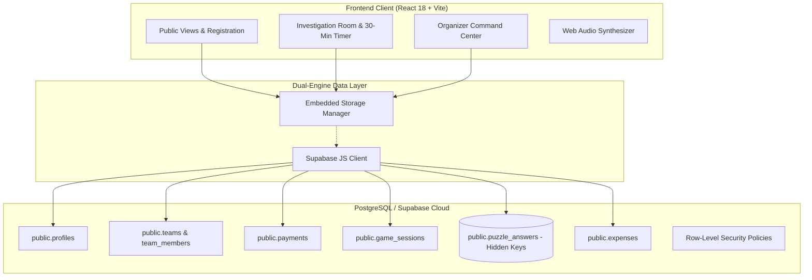

<div align="center">

# 🕵️‍♂️ CAMPUS QUEST — THE MISSING FILE
### *Collegiate Business Mystery, Forensic Escape Room & Live Competition Platform*

[](https://reactjs.org/)
[](https://www.typescriptlang.org/)
[](https://vitejs.dev/)
[](https://tailwindcss.com/)
[](https://supabase.com/)
[](LICENSE)

*A production-grade, immersive campus event platform engineered for real collegiate business challenges, hackathons, and escape room competitions.*

---

[Key Highlights](#-key-highlights) • 
[Forensic Storyline](#-case-001--the-missing-file) • 
[Core Features](#-core-features) • 
[Architecture](#-system-architecture) • 
[Quick Start](#-quick-start) • 
[Organizer Guide](#-organizer-command-center) • 
[Database Setup](#-database--supabase-integration) • 
[Deployment](#-deployment)

</div>

---

## 📌 Executive Summary

**Campus Quest — The Missing File** is a full-stack, time-critical event web application built to run real collegiate business competitions. Designed as an investigative cyber-forensic challenge, teams of **2 to 4 students** pay a ₹30 registration fee per player, verify their payment via UPI transaction reference, and race against a **live 30-minute countdown clock** to solve 5 interconnected puzzle stages before time expires.

The platform provides dual-mode flexibility:
1. **Zero-Config Local Mode**: Runs entirely client-side out of the box using an embedded storage engine.
2. **Cloud Mode (Supabase / PostgreSQL)**: Enterprise-ready multi-device synchronization with Row-Level Security (RLS) for college-wide competitions.

---

## 🔍 Case 001 — The Missing File

> *"At 08:30 AM on audit day, the Dean's confidential National Accreditation Dossier disappeared from the high-security archive safe. Without this file, the university faces severe sanctions. Four campus staff were inside the administration block. You and your squad have exactly 30 minutes to sift through corrupted logs, crack vault ciphers, interrogate suspects, and retrieve the file."*

### The Forensic Stages:
1. **Stage 1: Corrupted Server Access Logs** — Sift through timestamped Apache/SSH log dumps to identify the exact anomalous access vector.
2. **Stage 2: Keycard Scrambler in the Vault** — Decrypt an encoded 4-digit numeric keypad pin using a built-in interactive Caesar Cipher decoder.
3. **Stage 3: Witness Cross-Examination** — Inspect suspect alibis, cross-reference conflicting testimonies, and pinpoint the perjurer.
4. **Stage 4: Tampered CCTV Metadata** — Extract hidden hexadecimal strings and camera status flags from surveillance feeds.
5. **Stage 5: The Dean's Master Safe** — Combine forensic artifacts, identify the mastermind, and enter the master vault access passphrase.

---

## ✨ Core Features

### 👥 Participant & Squad Portal
- **Streamlined Team Registration**: Real-time fee calculation (₹30/player, 2–4 players), automated squad code assignment (`CQ-XXXX`), and private access key generation.
- **UPI QR Payment Workflow**: Direct scan-to-pay interface supporting GPay, PhonePe, Paytm, and BHIM with live UTR/transaction reference submission.
- **Live Investigation Room**:
  - Central 30-minute countdown mission clock with procedural audio alerts.
  - Interactive forensic toolset (Caesar Cipher wheel, dossier inspector, suspect bios).
  - Hint system adding a calibrated **120-second time penalty** per requested clue.
- **Real-Time Leaderboard**: Evaluates squads dynamically based on total score (up to 100 PTS) with fastest completion time breaking ties.
- **Instant Certificate Generation**: Automated digital finisher certificates with team name, score, and timestamp.

### 🛡️ Chief Organizer Command Center
- **Secure Gatekeeping**: Passcode-protected access (`campusquest2026` or `admin`).
- **Payment Verification Bureau**:
  - One-click approval / rejection of submitted UPI reference codes.
  - Rejection feedback system for invalid transaction proofs.
- **Master Game Session Controls**:
  - Remotely start, monitor, or force-expire 30-minute team timers.
  - View live progress, active stages, and penalty totals.
- **Financial Audit Ledger**:
  - Initial competition capital tracking (**₹1,000** baseline).
  - Live revenue calculation from verified payments.
  - Custom expense logger with category classification (*Prizes*, *Printing*, *Operations*, *Marketing*).
  - Net profit, closing cash, and capital-to-return metrics dynamically computed.
  - One-click **CSV Report Export** for official university submissions.
- **Safe Demo Data Reset Dialog**:
  - Selective Demo Purge (removes demo fixtures, keeps real participants).
  - Full Day-1 Clean State Reset (requires explicit confirmation text `RESET DEMO DATA`).

### 🎵 Procedural Web Audio Engine
- Built-in zero-dependency Web Audio API synthesizer for sound effects:
  - Terminal key clicks, forensic clue unlocks, countdown urgency ticks, success chimes, and failure buzzers.
  - Fully accessible with a one-click mute/unmute control.

---

## 🏗️ System Architecture



---

## 🚀 Quick Start

### Prerequisites
- **Node.js**: v18.0.0 or higher
- **npm**: v9.0.0 or higher

### Installation

1. **Clone the repository**:
   ```bash
   git clone https://github.com/kewatrinku967-pixel/Campusquest123.git
   cd Campusquest123
   ```

2. **Install dependencies**:
   ```bash
   npm install
   ```

3. **Start the development server**:
   ```bash
   npm run dev
   ```
   Open [http://localhost:5173](http://localhost:5173) in your browser.

4. **Build for production**:
   ```bash
   npm run build
   ```

---

## 🔑 Organizer Credentials & Demo Access

| Portal | URL / Action | Access Key / Credentials |
| :--- | :--- | :--- |
| **Public Portal** | `http://localhost:5173` | Public access |
| **Organizer Bureau** | Click **"Admin Access"** in Navbar / Footer | Passcode: `campusquest2026` or `admin` |
| **Reset Demo Data** | Organizer Bureau → Reset Button | Confirmation: Type `RESET DEMO DATA` |

---

## 🗄️ Database & Supabase Integration

Campus Quest includes full PostgreSQL database migrations located in the [`supabase/migrations/`](supabase/migrations/) directory:

| Migration File | Description |
| :--- | :--- |
| `20261124000100_initial_schema.sql` | 11 core tables (`profiles`, `teams`, `payments`, `game_sessions`, `expenses`, etc.) |
| `20261124000200_security.sql` | Row-Level Security (RLS) policies, triggers, and role permissions |
| `20261124000300_seed_puzzles.sql` | Official 5-stage puzzle content and private server answer keys |
| `20261125000100_clean_demo_data.sql` | Controlled transactional purge script & RPC maintenance procedure |

### Connecting to Cloud Supabase:
1. Create a project at [supabase.com](https://supabase.com).
2. Run the migrations in the Supabase SQL Editor in sequence.
3. Create a `.env` file in the root directory:
   ```env
   VITE_SUPABASE_URL=https://YOUR_PROJECT_ID.supabase.co
   VITE_SUPABASE_ANON_KEY=YOUR_SUPABASE_ANON_KEY
   ```

---

## 📁 Project Structure

```text
campus-quest/
├── src/
│   ├── components/            # UI components (Navbar, Modals, Suspects, Cipher Tool)
│   │   ├── CaesarCipherTool.tsx   # Interactive forensic decryption utility
│   │   ├── CertificateModal.tsx   # Digital achievement certificate
│   │   ├── LoginModal.tsx         # Participant squad authentication
│   │   ├── RegisterModal.tsx      # Multi-step registration & UPI gateway
│   │   └── PricingCalculator.tsx  # Dynamic fee estimator
│   ├── data/
│   │   └── puzzles.ts             # Official Case 001 stages, suspect dossiers & clues
│   ├── lib/
│   │   └── supabase/              # Supabase client instantiation & TypeScript models
│   ├── services/
│   │   └── api.ts                 # Asynchronous cloud database operations
│   ├── types/
│   │   └── index.ts               # Central domain interfaces & data contracts
│   ├── utils/
│   │   ├── sound.ts               # Procedural Web Audio API sound generator
│   │   └── storage.ts             # Local storage manager with clean-state analytics
│   ├── views/
│   │   ├── AdminDashboardView.tsx # Chief Organizer Command Center & Audit Ledger
│   │   ├── InvestigationRoomView.tsx # 30-minute forensic game session interface
│   │   ├── LandingView.tsx        # Event homepage & mystery brief
│   │   └── LeaderboardView.tsx    # Live rankings & podium display
│   ├── App.tsx                # Main view router & session coordinator
│   └── main.tsx               # Application entry point
├── supabase/
│   └── migrations/            # Production PostgreSQL SQL migrations
├── netlify.toml               # Single-page application routing for Netlify
├── vercel.json                # SPA rewrite rules for Vercel
├── tailwind.config.js         # Theme styling, cyberpunk glow & forensic palette
└── package.json
```

---

## 🌐 Deployment

### Deploy to Netlify
1. Connect your GitHub repository to [Netlify](https://www.netlify.com).
2. Set Build Command: `npm run build`
3. Set Publish Directory: `dist`
4. The included `netlify.toml` automatically handles SPA route rewrites.

### Deploy to Vercel
1. Import repository on [Vercel](https://vercel.com).
2. Framework Preset: **Vite**
3. Build Command: `npm run build`
4. Output Directory: `dist`
5. The included `vercel.json` ensures full client-side routing support.

---

## 📜 Competition Rules Summary

- **Team Composition**: Exactly 2 to 4 registered college students.
- **Registration Fee**: ₹30 per player.
- **Game Clock**: 30 minutes (1,800 seconds) enforced by the server/organizer.
- **Scoring**: Maximum 100 points across 5 forensic stages.
- **Penalty**: Each requested hint adds a **120-second time penalty** to the squad's total clock.
- **Tie-Breaking**: Higher score takes priority; identical scores are ranked by lowest elapsed time.

---

## 📄 License

This project is licensed under the [MIT License](LICENSE).

<div align="center">
<sub>Built with 🕵️‍♂️ for collegiate mystery challenges, case competitions, and forensic escape rooms.</sub>
</div>
